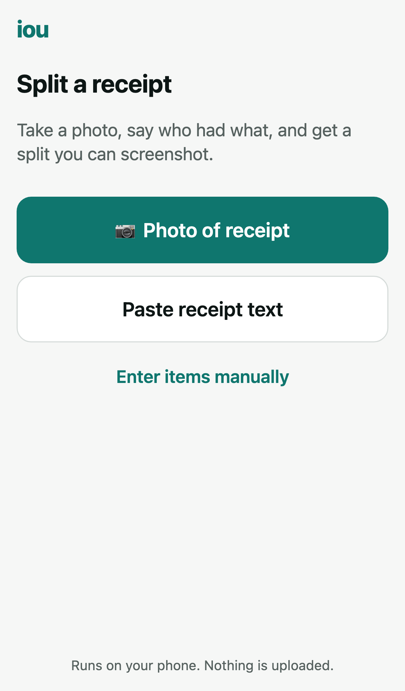
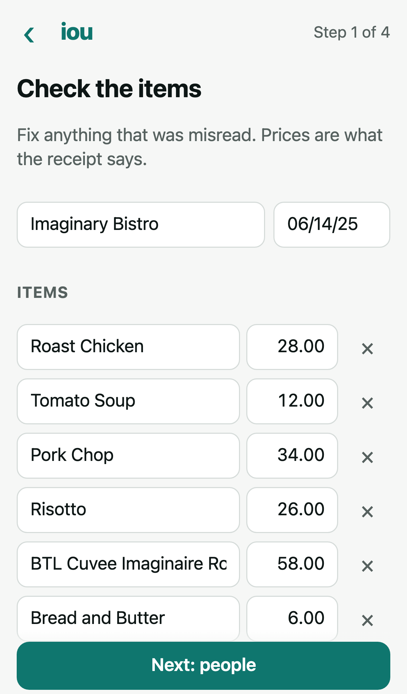
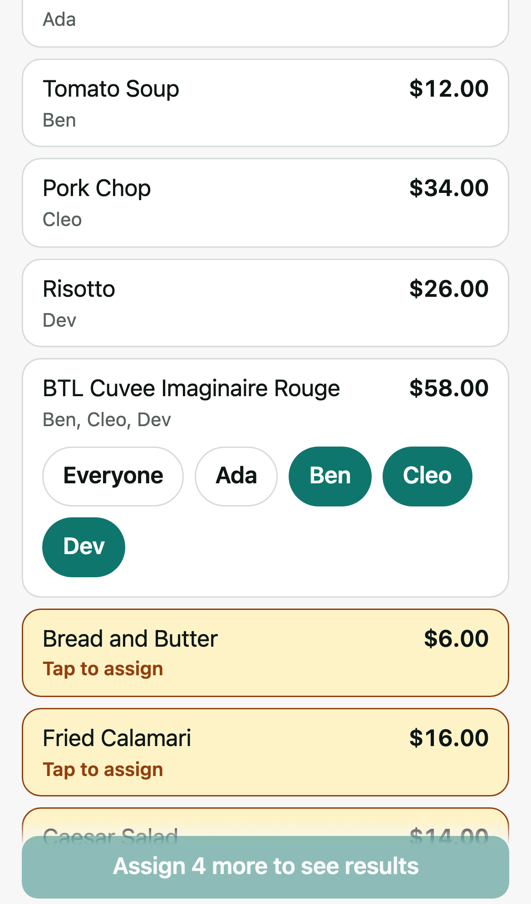
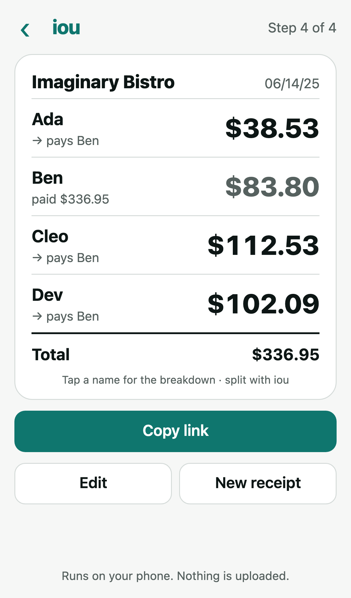
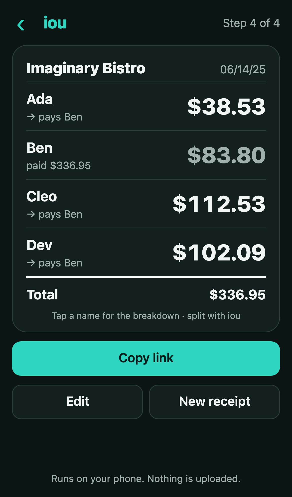

# iou

Photograph a receipt, say who had what, get a split you can screenshot.

**Everything runs on your phone.** The receipt is read with an OCR engine bundled into the page
(tesseract.js, compiled to WebAssembly). There is no server, no API key, and no network request after the
page loads. Share links carry the split in the URL hash (`#s=…`), which browsers never send to a server.

<p>
  
  
  
  
  
</p>

## How it works

1. **Capture.** Take or pick a photo, or drag one onto the page on a desktop. HEIC photos (for example,
   dragged out of Messages on a Mac) work in every browser: Safari decodes them natively, and elsewhere a
   bundled libheif decoder loads on demand. You can also paste text (iOS Live Text or Google Lens can copy
   text from a photo) or type the items in by hand.
2. **Crop.** The receipt is detected automatically as the largest bright, low-saturation region. Adjust
   the corners if needed. Cropping matters more than resolution: on an uncropped photo, OCR reads wood grain
   as text.
3. **Read.** The crop is converted to grayscale, auto-contrasted, resized to about 2,000 px tall, and OCR'd
   on the device.
4. **Items.** Fix any misreads. A badge turns green when items plus tax, tip, and fees match the printed
   total to the cent.
5. **People → Assign → Results.** Each item is split evenly among the people who shared it. Tax, tip, fees,
   and discounts are split in proportion to each person's items. Totals are rounded with the
   largest-remainder method, so they always add up to the receipt total exactly.

Recently used names are remembered in `localStorage` on your device only. The app installs to the home
screen and works offline once it has loaded.

## Development

No build step. The repo root is the site. `package.json` is for dev and test tooling only.

```sh
npm ci
npx playwright install chromium
npm run serve          # http://127.0.0.1:8080
npm test               # unit + OCR integration + e2e
```

| Script | What it does |
|---|---|
| `npm run test:unit` | `node --test`: split math, parser, service-worker manifest check |
| `npm run test:ocr` | Real photo → crop → OCR → parse. Skipped unless `fixtures/private/` has a photo and `expected.json` |
| `npm run test:e2e` | Playwright on Chromium with an iPhone 13 viewport and touch. Asserts nothing leaves localhost |
| `npm run vendor` | Copies the pinned tesseract.js and libheif files from `node_modules` into `vendor/` |
| `npm run sw` | Updates the service-worker cache version (a content hash). A unit test fails if it's stale |
| `npm run icons` | Renders `icons/icon.svg` to PNGs |
| `npm run screenshots` | Regenerates `docs/screenshots/` from the text fixture |

**After changing any app file, run `npm run sw`.** The cache version is a hash of the precached files, so
installed copies pick up the change. While developing with the service worker active, turn on
"Update on reload" in DevTools, or the page will serve cached files.

### Private fixtures

Real receipt photos go in `fixtures/private/`, which is gitignored: receipts carry card digits, names, and
approval codes. Convert HEIC first, for example `sips -s format jpeg IMG_1234.heic --out fixtures/private/receipt.jpg`.
Next to the photo, add `fixtures/private/expected.json` with what it should read as (`prices`, `subtotal`,
`total`, `extras`, `merchant`, `date`; amounts in cents). See `test/e2e/helpers.js` for the shape. The committed
test fixtures use a made-up receipt.

## Layout

```
index.html, app.css          app shell
src/split.js                 pure: items + assignments + extras → per-person totals (cents)
src/parse.js                 pure: OCR text → merchant, date, items, extras, subtotal, total
src/image.js                 receipt detection, grayscale/autocontrast, resize
src/ocr.js                   tesseract.js wrapper (local files only)
src/state.js                 app state, URL-hash encode/decode, recent names
src/ui/*.js                  screens
src/heic.js                  HEIC fallback for browsers without a native decoder
vendor/tesseract/            tesseract.js 5.1.1, LSTM cores 5.1.1, eng 4.0.0_best_int (see VERSIONS.json)
vendor/libheif/              libheif-js 1.23.5 (LGPL-3.0), loaded only for HEIC photos
sw.js, manifest.webmanifest  offline + Add to Home Screen
```

## Deploy

Push to GitHub, then go to Settings → Pages → Deploy from branch → `main` / root. The site is served from
`eigenvivek.github.io/iou`. All paths are relative.

## Known limitations

- One payer per receipt. The data model and `settle()` support several receipts and payers, but the UI
  doesn't expose them yet.
- No Venmo request links. The deep-link format hasn't been verified on a real phone.
- Tip is always split in proportion to each person's items. There's no even-split toggle.
- The parser expects US-style prices (`12.34`) and `M/D/YY` dates.
- E2E tests run on Chromium only. Playwright's WebKit build doesn't start on macOS 14, so check Safari by
  hand on a phone.
- The first visit downloads about 9 MB for offline use (the OCR engine and English model). The 1.5 MB HEIC
  decoder downloads only the first time someone opens a HEIC in a browser that can't decode it natively,
  and is cached after that.
- HEIC decoding outside Safari runs on the main thread. A 24 MP photo takes about 2 s on a laptop.
